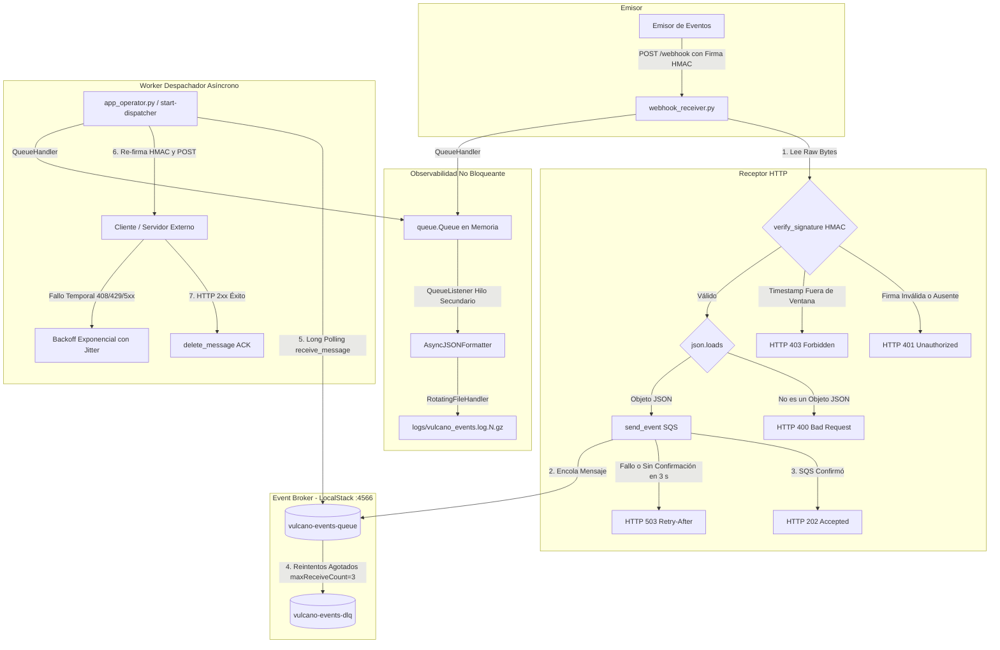

# README - Proyecto Vulcano (Vulcano Pay)

Plataforma de notificaciones financieras desarrollada para el Trabajo Práctico N° 2 (Proyecto Vulcano) de *Programación para Automatización II*.

## Descripción General
El sistema implementa una **Arquitectura Orientada a Eventos (EDA)** que desacopla la recepción HTTP de peticiones del envío externo mediante **AWS SQS** (emulado localmente en **LocalStack**), garantizando seguridad criptográfica con firmas **HMAC-SHA256**, reintentos con *Backoff Exponencial con Jitter*, observabilidad no bloqueante en JSON y tolerancia a fallos mediante una **Dead Letter Queue (DLQ)**.

---

## 1. Arquitectura del Sistema

El flujo de procesamiento sigue la **Regla de Oro de los Webhooks**: confirmación rápida en la frontera HTTP (<100 ms) con respuesta `HTTP 202 Accepted` y procesamiento asíncrono diferido.



---

## 2. Estructura Modular del Proyecto


```text
vulcano-pay/
├── pyproject.toml
├── requirements.txt
├── README.md
├── src/
│   └── vulcano_telemetry/
│       ├── __init__.py          # Expone la API pública del paquete con __all__
│       ├── exceptions.py        # Jerarquía semántica de excepciones (hereda de Exception)
│       ├── sanitizer.py         # Validadores declarativos de la CLI con argparse
│       ├── core_sqs.py          # Cliente Boto3 SQS, producción y consumo Long Polling
│       ├── webhook_crypto.py    # Generación y verificación de firmas HMAC-SHA256
│       ├── webhook_receiver.py  # Servidor HTTP Receptor (FastAPI / Uvicorn)
│       ├── logging_engine.py    # Pipeline de logs JSON asíncrono con compresión Gzip
│       └── app_operator.py      # Punto de entrada CLI y orquestador del Despachador
└── tests/
    ├── test_chaos.py            # Inyección de fallos, firmas corruptas y replay attacks
    └── test_forensic_log.py     # Inspección de logs JSON y descompresión .gz
```


## 3. Distribución de Roles e Integrantes

| Rol | Responsabilidad Principal | Módulos a Cargo | Entregables / Evidencia |
| :--- | :--- | :--- | :--- |
| **Integrante 1 (I1)** | **Ingeniera de Robustez de Entradas y Excepciones** | `exceptions.py`, `sanitizer.py`, `__init__.py` | Jerarquía `VulcanoError`, sanitización CLI con `argparse.ArgumentTypeError` y definición de `__all__`. |
| **Integrante 2 (I2)** | **Ingeniero de Concurrencia y Mensajería Cloud** | `core_sqs.py` | Conexión Boto3 a LocalStack (:4566), `produce_event`, *Long Polling* y configuración de `RedrivePolicy` con DLQ. |
| **Integrante 3 (I3)** | **Ingeniero de Criptografía y Receptor HTTP** | `webhook_crypto.py`, `webhook_receiver.py` | Firma/Validación HMAC-SHA256 en tiempo constante, prevención de Replay Attacks (300s) y servidor FastAPI. |
| **Integrante 4 (I4)** | **Ingeniero de Observabilidad y Logging Estructurado** | `logging_engine.py` | `AsyncJSONFormatter` con serialización UTC/ISO 8601, pipeline `QueueHandler`/`QueueListener` y rotación Gzip. |
| **Integrante 5 (I5)** | **Coordinador de Integración y Despachador CLI** | `app_operator.py` | Orquestador CLI (`send-webhook` y `start-dispatcher`), re-emisión HTTP con *Full Jitter* y cierre limpio (PEP 765). |
| **Integrante 6 (I6)** | **Ingeniero de Simulación de Caos y Diagnóstico** | `tests/test_chaos.py`, `test_forensic_log.py` | Suite de pruebas automatizadas contra firmas corruptas, mensajes venenosos (*poison messages*) y auditoría JSON/Gzip. |

---

## 4. Módulos y Requisitos Técnicos

### 4.1. Excepciones Semánticas y Sanitización CLI (Integrante 1)
- **`exceptions.py`**: La clase base `VulcanoError` hereda de `Exception` (nunca de `BaseException`). Subclases: `SQSConnectionError`, `QueueTimeoutError`, `CorruptedMessageError`, `WebhookSignatureError`, `WebhookTimestampError`, `WebhookDeliveryError`.
- **`sanitizer.py`**: Validadores `parse_queue_name` (regex `^vulcano-[a-z0-9-]+-queue$`), `parse_wait_time` (1-20s), `parse_webhook_url` (HTTP/HTTPS) y `parse_secret_key` (>=16 chars). Todos lanzan `argparse.ArgumentTypeError`.
- **`__init__.py`**: Exporta la API pública mediante `__all__`.

### 4.2. Criptografía y Receptor HTTP (Integrante 3)
Este rol autentica cada webhook y responde rápido en la frontera HTTP. Solo llega a SQS lo que tiene una firma válida y está dentro de la ventana de tiempo.

#### `webhook_crypto.py`: firma y verificación HMAC-SHA256

La firma viaja en esta cabecera:

```text
X-Webhook-Signature: t=1700000000,v1=<firma hexadecimal de 64 caracteres>
```

| Función | Qué hace |
| :--- | :--- |
| `generate_signature(secret, timestamp, payload_bytes)` | Devuelve la firma HMAC-SHA256 en hexadecimal sobre `f"{timestamp}.".encode() + payload_bytes`. El timestamp forma parte de lo firmado, así que no se puede modificar sin invalidar la firma. |
| `build_signature_header(secret, payload_bytes, timestamp=None)` | Arma el valor de la cabecera. Sin `timestamp`, usa la hora actual. |
| `verify_signature(secret, header_value, payload_bytes, tolerance_sec=300)` | Devuelve `True` si el webhook es válido y, si no, lanza una excepción del dominio. `tolerance_sec` admite de 1 a 300 segundos; fuera de ese rango lanza `ValueError`. |

`verify_signature` controla en este orden:

1. **Formato de la cabecera.** `t` acepta de 1 a 15 dígitos y `v1`, exactamente 64 caracteres hexadecimales en minúscula. Si la cabecera falta o tiene otro formato, lanza `WebhookSignatureError`. Así, `int()` y `compare_digest()` nunca reciben datos que provoquen un `ValueError` o un `TypeError` y terminen en HTTP 500.
2. **Ventana de tiempo (*Replay Attack*).** Si `abs(time.time() - t)` supera la tolerancia, lanza `WebhookTimestampError` y agrega con `add_note()` el timestamp recibido y la hora del servidor. `abs()` también rechaza timestamps del futuro. Este control va antes del HMAC para descartar webhooks viejos sin gastar CPU.
3. **Firma (*Timing Attack*).** Compara con `hmac.compare_digest()`, que tarda lo mismo sin importar dónde esté la diferencia. Si no coinciden, lanza `WebhookSignatureError`.
#### `webhook_receiver.py`: servidor FastAPI

Expone `POST /webhook` para recibir webhooks y `GET /health`, que responde `{"status": "ok"}`. Por defecto escucha en `127.0.0.1:8000`.

`POST /webhook` sigue estos pasos:

1. Lee los bytes crudos con `await request.body()`. La firma se verifica sobre esos bytes exactos, porque volver a serializar el JSON cambiaría los espacios o el orden de las claves.
2. Llama a `verify_signature`. Ningún contenido se interpreta antes de autenticarlo.
3. Interpreta el cuerpo con `json.loads` y exige que sea un objeto JSON.
4. Arma el evento que va a la cola.
5. Publica con `core_sqs.send_event`. Como Boto3 es bloqueante, corre en un hilo con `asyncio.to_thread`, y `asyncio.wait_for` limita la espera a 3 segundos.
6. Registra la latencia y responde `HTTP 202 Accepted` cuando SQS ya confirmó.

| Situación | Respuesta |
| :--- | :--- |
| Webhook válido y publicado en SQS | `202 Accepted` con `status`, `message_id`, `trace_id` y `webhook_id` |
| Cuerpo que no es JSON o que no es un objeto | `400 Bad Request` |
| Firma inválida, ausente o con formato incorrecto | `401 Unauthorized` |
| Timestamp fuera de la ventana de 5 minutos | `403 Forbidden` |
| SQS falla o no confirma en 3 segundos | `503 Service Unavailable` con `Retry-After: 5` |

Como la ventana de tiempo se controla primero, una firma falsa con un timestamp vencido recibe `403` y no `401`. El emisor solo recibe un mensaje genérico; el detalle queda en el log.

El evento publicado en `vulcano-events-queue` es un sobre con los datos de trazabilidad y el `payload` original:

```json
{
  "webhook_id": "4bcf972b88364b37b6fc9d3d180205ed",
  "trace_id": "d270889b335443f99a93a8971d42f174",
  "received_at": "2026-11-02T03:16:01.954520+00:00",
  "payload": {
    "transaction_id": "tx_9981",
    "amount": 350.0
  }
}
```

**Configuración**

| Parámetro | Valor por defecto | Descripción |
| :--- | :--- | :--- |
| `secret` | Variable de entorno `VULCANO_WEBHOOK_SECRET` | Clave HMAC compartida con el emisor. Nunca va en el código. Sin clave, `create_app` lanza `RuntimeError` y el servidor no arranca. |
| `queue_url` | `http://localhost:4566/000000000000/vulcano-events-queue` | Cola donde se publica. |
| `endpoint_url` | `http://localhost:4566` | Endpoint de LocalStack. |
| `publisher` | Publicador de `core_sqs` | Función que recibe el evento y devuelve el `MessageId`. Se puede reemplazar para probar el receptor sin SQS. |
| `publish_timeout` | `3.0` | Segundos máximos de espera de la confirmación de SQS. |
| `host`, `port` | `127.0.0.1`, `8000` | Parámetros de `run_receiver`, la función pensada para el subcomando `start-receiver` de `app_operator.py`. |

El emisor puede enviar la cabecera opcional `X-Webhook-Id` para identificar sus entregas. Se respeta si cumple `[A-Za-z0-9_.:-]{1,128}`; si no, se genera un identificador nuevo. Esta cabecera no está cubierta por la firma.

**Decisiones de diseño**

- **`202` solo con el evento en la cola:** si SQS falla, el receptor responde `503` y el emisor sabe que tiene que reintentar. Responder antes de publicar sería más rápido, pero el evento se perdería.
- **Límite de 3 segundos:** sin él, con LocalStack caído, Boto3 sigue reintentando unos 18 segundos y el emisor queda esperando.
- **Un solo cliente Boto3:** se crea al iniciar, porque crearlo en cada petición cuesta cientos de milisegundos.
- **Un solo `trace_id` por webhook:** el receptor se lo pasa a `send_event`, y así logs y atributos de SQS comparten el mismo identificador.

**Latencia**

En pruebas locales contra LocalStack, tandas de 30 webhooks dieron una mediana de 53 a 61 ms y un máximo por debajo de 80 ms, con la confirmación de SQS incluida. No es una garantía absoluta: depende del entorno y la primera petición tarda más porque Boto3 abre la conexión.

**Limitaciones conocidas**

- Un webhook capturado se puede reenviar dentro de los 5 minutos de la ventana, porque el receptor no guarda las firmas ya vistas.
- `wait_for` corta la espera, no la publicación: SQS podría confirmar después del `503` y el reintento generar un duplicado. El `webhook_id` permite detectarlo si el emisor repite su `X-Webhook-Id`, pero el receptor no descarta duplicados.
- HMAC garantiza autenticidad e integridad, no confidencialidad. En producción el tráfico tiene que ir por HTTPS.

**Ejecución**

Desde la raíz del repositorio, con las dependencias instaladas:

```powershell
docker run -d --name vulcano-localstack -p 4566:4566 -e SERVICES=sqs localstack/localstack:4.14.0
$env:VULCANO_WEBHOOK_SECRET = "<clave compartida con el emisor>"
$env:PYTHONPATH = "src"
```

```python
from vulcano_telemetry.core_sqs import get_sqs_client, setup_queues
from vulcano_telemetry.logging_engine import (
    setup_vulcano_logging,
    stop_vulcano_logging,
)
from vulcano_telemetry.webhook_receiver import run_receiver

ENDPOINT = "http://localhost:4566"

logger = setup_vulcano_logging("logs/vulcano_events.log")
queue_url, _ = setup_queues(get_sqs_client(ENDPOINT))
try:
    run_receiver(queue_url=queue_url, endpoint_url=ENDPOINT)
finally:
    stop_vulcano_logging(logger)
```

### 4.3. Mensajería SQS y DLQ (Integrante 2)
- **`core_sqs.py`**: Conexión Boto3 a LocalStack (`http://localhost:4566`). Vinculación de `vulcano-events-queue` con `vulcano-events-dlq` usando `RedrivePolicy` (`maxReceiveCount=3`).

### 4.4. Observabilidad y Logging JSON (Integrante 4)
`logging_engine.py` genera registros JSON estructurados sin frenar al hilo que loguea. Escribir en disco es lento, así que esa tarea queda separada de la lógica del sistema, y todos los módulos usan el mismo pipeline.

| Elemento | Qué hace |
| :--- | :--- |
| `setup_vulcano_logging(log_filename="vulcano_events.log", level=logging.INFO, console=False)` | Configura el pipeline y devuelve el logger `vulcano_engine`. Llamarla otra vez no duplica handlers ni hilos. Con `console=True` también escribe en la consola. |
| `stop_vulcano_logging(logger=None)` | Vacía la cola, detiene el hilo del listener y cierra los archivos. Llamarla más de una vez no tiene efecto. |
| `AsyncJSONFormatter` | Convierte cada `LogRecord` en una línea JSON. |
| `serialize_exception(exc)` | Convierte una excepción en un diccionario, de forma recursiva. |
| `VulcanoQueueHandler` | Subclase de `QueueHandler` que conserva la excepción original. |
| `gzip_namer`, `gzip_rotator` | Callbacks de nombre y compresión de los respaldos. |

#### Pipeline no bloqueante

```text
Hilo que loguea -> VulcanoQueueHandler -> queue.Queue -> QueueListener (hilo secundario)
                                                              |
                                                              v
                                       AsyncJSONFormatter -> RotatingFileHandler
```

- El hilo que loguea solo encola el registro. Toda la escritura en disco pasa por el par `QueueHandler`/`QueueListener`.
- `VulcanoQueueHandler` sobrescribe `prepare()`. El método estándar borra `exc_info` porque está pensado para colas entre procesos que necesitan *pickle*. Acá la cola está en memoria, así que se conserva `exc_info` para que el formateador pueda serializar un `ExceptionGroup`. El mensaje se resuelve en el hilo que loguea.
- `logger.propagate = False` evita que los registros se dupliquen en otros handlers.

#### Formato de cada registro

Cada evento es una línea JSON. Con formato legible, un registro exitoso del receptor se ve así:

```json
{
  "timestamp": "2026-11-02T03:16:01.955407+00:00",
  "level": "INFO",
  "logger": "vulcano_engine.receiver",
  "message": "Webhook verificado y encolado en SQS.",
  "TraceId": "d270889b335443f99a93a8971d42f174",
  "MessageId": "7f3c2a10-5b1e-4c8d-9a26-1e0d4b7c6f35",
  "WebhookId": "4bcf972b88364b37b6fc9d3d180205ed",
  "process": 20020,
  "threadName": "MainThread",
  "X-Webhook-Signature": "t=1793589361,v1=1b0cb967dcd95749bd034ed3e1da4bed911e28ec1239bf78784eea3950fce6f2",
  "latency_ms": 52.38
}
```

| Campo | Contenido |
| :--- | :--- |
| `timestamp` | Fecha ISO 8601 en UTC. Sale de `record.created` y no de `datetime.now()`, porque el formateador corre en el listener, después de que ocurrió el evento. |
| `level`, `logger`, `message` | Datos estándar del registro. |
| `TraceId`, `MessageId`, `WebhookId` | Campos de correlación entre módulos. Aparecen siempre, en `null` si no aplican. En el código se pasan por `extra` como `trace_id`, `message_id` y `webhook_id`. |
| `process`, `threadName` | Proceso e hilo que generaron el registro. |
| `X-Webhook-Signature` | Cabecera de firma recibida, pasada por `extra` como `webhook_signature`. |
| Otros atributos de `extra` | Se agregan con su nombre, como `latency_ms`, sin pisar los campos base. Los que no son serializables se guardan como texto. |
| `exception` | Árbol de la excepción, si el registro tiene una. |

#### Serialización recursiva de excepciones

Cada nodo tiene `type`, `message`, `notes` (de `add_note()`) y `traceback`, una lista de frames con `file`, `line`, `function` y `code`. Además, según el caso:

- `exceptions`: sub-excepciones de un `ExceptionGroup`, incluidos los grupos anidados.
- `cause`: causa encadenada con `raise ... from err`.
- `context`: contexto implícito, si no hay causa.
- `circular_reference`: marca un ciclo y corta la recursión.

Este es el campo `exception` de un replay rechazado, con la traza recortada a un frame:

```json
{
  "type": "vulcano_telemetry.exceptions.WebhookTimestampError",
  "message": "Timestamp fuera de tolerancia (3600s > 300s).",
  "notes": [
    "Timestamp recibido: 1793585762 | hora del servidor: 1793589362"
  ],
  "traceback": [
    {
      "file": "src/vulcano_telemetry/webhook_crypto.py",
      "line": 120,
      "function": "verify_signature",
      "code": "raise err"
    }
  ]
}
```

#### Rotación y compresión atómica

`RotatingFileHandler` rota el archivo a los 2 MB y conserva 3 respaldos comprimidos:

```text
vulcano_events.log
vulcano_events.log.1.gz
vulcano_events.log.2.gz
vulcano_events.log.3.gz
```

`gzip_rotator` escribe primero un archivo `.tmp` y recién al terminar lo renombra con `os.replace()`. El log original se borra al final. Si la compresión falla, se elimina el temporal y se conserva el original, así que nunca queda un `.gz` truncado.

En una prueba con unos 11 MB de logs quedaron el archivo actual y 3 `.gz`, y cada respaldo tenía solo líneas JSON válidas.

#### Cierre ordenado

`stop_vulcano_logging` está pensada para el `finally` de `app_operator.py`. Si la aplicación termina sin llamarla, `atexit` la ejecuta igual para no perder lo encolado. El módulo cumple PEP 765 porque no tiene bloques `finally`.

**Limitaciones conocidas**

- Si el proceso se mata a la fuerza, se pierde lo que todavía estaba en la cola. Es el costo del logging asíncrono.
- La cola no tiene límite (`queue.Queue(-1)`): nunca bloquea ni descarta registros, pero si el disco se traba, la memoria crece.

#### Uso

```python
import logging

from vulcano_telemetry.logging_engine import (
    setup_vulcano_logging,
    stop_vulcano_logging,
)

root_logger = setup_vulcano_logging("logs/vulcano_events.log")
logger = logging.getLogger("vulcano_engine.mi_modulo")
try:
    logger.info(
        "Evento procesado.",
        extra={"trace_id": "abc123", "message_id": "m-1"},
    )
finally:
    stop_vulcano_logging(root_logger)
```

### 4.5. CLI y Despachador (Integrante 5)
- **`app_operator.py`**: Modos `send-webhook` y `start-dispatcher`. Re-emisión con *Backoff Exponencial con Full Jitter* y apagado limpio de listener en `finally`.

---

## 5. Matriz de Pruebas

| ID | Caso de Prueba | Entrada / Comando | Resultado Esperado |
| :--- | :--- | :--- | :--- |
| **TC01** | **Sanitización de Cola Inválida** | `--queue cola_invalida!` | `argparse.ArgumentTypeError`: Rechazo inmediato en la CLI (exit code 2). |
| **TC02** | **Clave Secreta Corta** | `--secret 123` | `argparse.ArgumentTypeError`: Exige al menos 16 caracteres. |
| **TC03** | **Firma HMAC Inválida** | Cabecera `X-Webhook-Signature` alterada | Respuesta `HTTP 401 Unauthorized`. |
| **TC04** | **Ataque de Repetición (Replay)** | Timestamp con antigüedad > 300s | Lanzamiento de `WebhookTimestampError` y respuesta `HTTP 403 Forbidden`. |
| **TC05** | **Flujo Nominal Exitoso** | Webhook firmado válido | Responde `HTTP 202 Accepted`, se encola en SQS y el Worker procesa con ACK. |
| **TC06** | **Mensaje Venenoso / Poison Message** | Payload JSON corrupto inyectado en SQS | Falla 3 veces y SQS lo deriva automáticamente a `vulcano-events-dlq`. |
| **TC07** | **Auditoría de Logs Forenses** | Lectura de `logs/vulcano_events.log.N.gz` | Logs serializados en JSON con ISO 8601 UTC y descompresión Gzip íntegra. |
