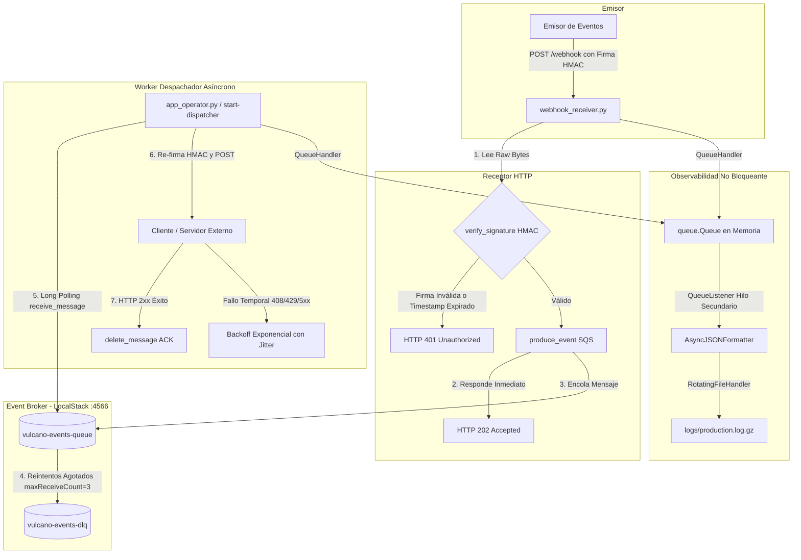

# README - Proyecto Vulcano (Vulcano Pay)

Plataforma de notificaciones financieras desarrollada para el Trabajo Práctico N° 2 (Proyecto Vulcano) de *Programación para Automatización II*.

## Descripción General
El sistema implementa una **Arquitectura Orientada a Eventos (EDA)** que desacopla la recepción HTTP de peticiones del envío externo mediante **AWS SQS** (emulado localmente en **LocalStack**), garantizando seguridad criptográfica con firmas **HMAC-SHA256**, reintentos con *Backoff Exponencial con Jitter*, observabilidad no bloqueante en JSON y tolerancia a fallos mediante una **Dead Letter Queue (DLQ)**.

---

## 1. Arquitectura del Sistema

El flujo de procesamiento sigue la **Regla de Oro de los Webhooks**: confirmación rápida en la frontera HTTP (<100 ms) con respuesta `HTTP 202 Accepted` y procesamiento asíncrono diferido.



---

## 2. Estructura Modular del Proyecto


vulcano-pay/
├── pyproject.toml
├── requirements.txt
├── README.md
├── src/
│   └── vulcano_telemetry/
│       ├── __init__.py          # Expone la API pública del paquete con __all__
│       ├── exceptions.py        # Jerarquía semántica de excepciones (hereda de Exception)
│       ├── sanitizer.py         # Validadores declarativos de la CLI con argparse
│       ├── core_sqs.py          # Cliente Boto3 SQS, producción y consumo Long Polling
│       ├── webhook_crypto.py    # Generación y verificación de firmas HMAC-SHA256
│       ├── webhook_receiver.py  # Servidor HTTP Receptor (FastAPI / Uvicorn)
│       ├── logging_engine.py    # Pipeline de logs JSON asíncrono con compresión Gzip
│       └── app_operator.py      # Punto de entrada CLI y orquestador del Despachador
└── tests/
    ├── test_chaos.py            # Inyección de fallos, firmas corruptas y replay attacks
    └── test_forensic_log.py     # Inspección de logs JSON y descompresión .gz
```


## 3. Distribución de Roles e Integrantes

| Rol | Responsabilidad Principal | Módulos a Cargo | Entregables / Evidencia |
| :--- | :--- | :--- | :--- |
| **Integrante 1 (I1)** | **Ingeniera de Robustez de Entradas y Excepciones** | `exceptions.py`, `sanitizer.py`, `__init__.py` | Jerarquía `VulcanoError`, sanitización CLI con `argparse.ArgumentTypeError` y definición de `__all__`. |
| **Integrante 2 (I2)** | **Ingeniero de Concurrencia y Mensajería Cloud** | `core_sqs.py` | Conexión Boto3 a LocalStack (:4566), `produce_event`, *Long Polling* y configuración de `RedrivePolicy` con DLQ. |
| **Integrante 3 (I3)** | **Ingeniero de Criptografía y Receptor HTTP** | `webhook_crypto.py`, `webhook_receiver.py` | Firma/Validación HMAC-SHA256 en tiempo constante, prevención de Replay Attacks (300s) y servidor FastAPI. |
| **Integrante 4 (I4)** | **Ingeniero de Observabilidad y Logging Estructurado** | `logging_engine.py` | `AsyncJSONFormatter` con serialización UTC/ISO 8601, pipeline `QueueHandler`/`QueueListener` y rotación Gzip. |
| **Integrante 5 (I5)** | **Coordinador de Integración y Despachador CLI** | `app_operator.py` | Orquestador CLI (`send-webhook` y `start-dispatcher`), re-emisión HTTP con *Full Jitter* y cierre limpio (PEP 765). |
| **Integrante 6 (I6)** | **Ingeniero de Simulación de Caos y Diagnóstico** | `tests/test_chaos.py`, `test_forensic_log.py` | Suite de pruebas automatizadas contra firmas corruptas, mensajes venenosos (*poison messages*) y auditoría JSON/Gzip. |

---

## 4. Módulos y Requisitos Técnicos

### 4.1. Excepciones Semánticas y Sanitización CLI (Integrante 1)
- **`exceptions.py`**: La clase base `VulcanoError` hereda de `Exception` (nunca de `BaseException`). Subclases: `SQSConnectionError`, `QueueTimeoutError`, `CorruptedMessageError`, `WebhookSignatureError`, `WebhookTimestampError`, `WebhookDeliveryError`.
- **`sanitizer.py`**: Validadores `parse_queue_name` (regex `^vulcano-[a-z0-9-]+-queue$`), `parse_wait_time` (1-20s), `parse_webhook_url` (HTTP/HTTPS) y `parse_secret_key` (>=16 chars). Todos lanzan `argparse.ArgumentTypeError`.
- **`__init__.py`**: Exporta la API pública mediante `__all__`.

### 4.2. Criptografía y Receptor HTTP (Integrante 3)
- **`webhook_crypto.py`**: Generación y verificación HMAC-SHA256 sobre `f"{timestamp}.".encode() + raw_bytes`. Ventana anti-replay de 300s y `hmac.compare_digest()`.
- **`webhook_receiver.py`**: Servidor FastAPI en puerto 8000. Recibe `POST /webhook`, valida la firma y encola en SQS devolviendo `HTTP 202 Accepted`.

### 4.3. Mensajería SQS y DLQ (Integrante 2)
- **`core_sqs.py`**: Conexión Boto3 a LocalStack (`http://localhost:4566`). Vinculación de `vulcano-events-queue` con `vulcano-events-dlq` usando `RedrivePolicy` (`maxReceiveCount=3`).

### 4.4. Observabilidad y Logging JSON (Integrante 4)
- **`logging_engine.py`**: `AsyncJSONFormatter` con timestamps ISO 8601 UTC. Pipeline no bloqueante `QueueHandler`/`QueueListener` con `RotatingFileHandler` y compresión `.gz`.

### 4.5. CLI y Despachador (Integrante 5)
- **`app_operator.py`**: Modos `send-webhook` y `start-dispatcher`. Re-emisión con *Backoff Exponencial con Full Jitter* y apagado limpio de listener en `finally`.

---

## 5. Matriz de Pruebas

| ID | Caso de Prueba | Entrada / Comando | Resultado Esperado |
| :--- | :--- | :--- | :--- |
| **TC01** | **Sanitización de Cola Inválida** | `--queue cola_invalida!` | `argparse.ArgumentTypeError`: Rechazo inmediato en la CLI (exit code 2). |
| **TC02** | **Clave Secreta Corta** | `--secret 123` | `argparse.ArgumentTypeError`: Exige al menos 16 caracteres. |
| **TC03** | **Firma HMAC Inválida** | Cabecera `X-Webhook-Signature` alterada | Respuesta `HTTP 401 Unauthorized`. |
| **TC04** | **Ataque de Repetición (Replay)** | Timestamp con antigüedad > 300s | Lanzamiento de `WebhookTimestampError` y respuesta `HTTP 401`. |
| **TC05** | **Flujo Nominal Exitoso** | Webhook firmado válido | Responde `HTTP 202 Accepted`, se encola en SQS y el Worker procesa con ACK. |
| **TC06** | **Mensaje Venenoso / Poison Message** | Payload JSON corrupto inyectado en SQS | Falla 3 veces y SQS lo deriva automáticamente a `vulcano-events-dlq`. |
| **TC07** | **Auditoría de Logs Forenses** | Lectura de `logs/production.log.gz` | Logs serializados en JSON con ISO 8601 UTC y descompresión Gzip íntegra. |
