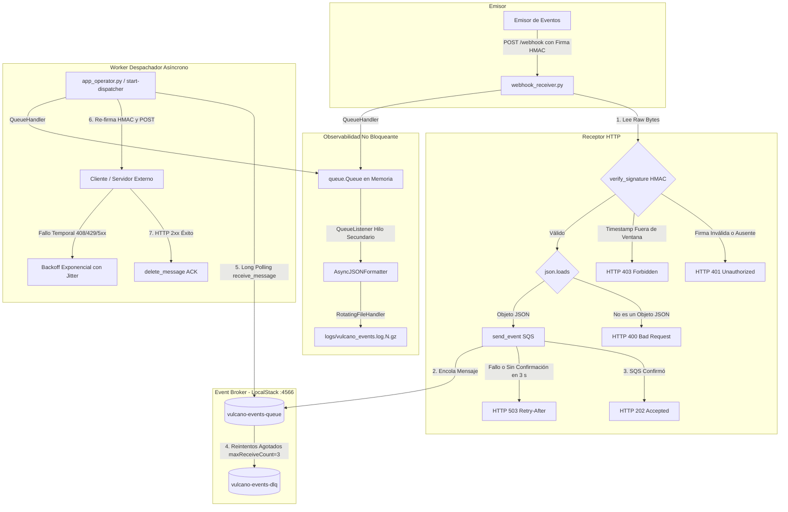

# Proyecto Vulcano (Vulcano Pay)

Plataforma de notificaciones financieras desarrollada para el Trabajo Práctico N° 2 (Proyecto Vulcano) de *Programación para Automatización II*.

## Descripción General
El sistema implementa una **Arquitectura Orientada a Eventos (EDA)** que desacopla la recepción HTTP de peticiones del envío externo mediante **AWS SQS** (emulado localmente en **LocalStack**), garantizando seguridad criptográfica con firmas **HMAC-SHA256**, reintentos con *Backoff Exponencial con Jitter*, observabilidad no bloqueante en JSON y tolerancia a fallos mediante una **Dead Letter Queue (DLQ)**.

---

## 1. Arquitectura del Sistema

El flujo de procesamiento sigue la **Regla de Oro de los Webhooks**: confirmación rápida en la frontera HTTP (<100 ms) con respuesta `HTTP 202 Accepted` y procesamiento asíncrono diferido.



---

## 2. Estructura Modular del Proyecto


```text
vulcano-pay/
├── pyproject.toml
├── requirements.txt
├── README.md
├── src/
│   └── vulcano_telemetry/
│       ├── __init__.py          # Expone la API pública del paquete con __all__
│       ├── exceptions.py        # Jerarquía semántica de excepciones (hereda de Exception)
│       ├── sanitizer.py         # Validadores declarativos de la CLI con argparse
│       ├── core_sqs.py          # Cliente Boto3 SQS, producción y consumo Long Polling
│       ├── webhook_crypto.py    # Generación y verificación de firmas HMAC-SHA256
│       ├── webhook_receiver.py  # Servidor HTTP Receptor (FastAPI / Uvicorn)
│       ├── logging_engine.py    # Pipeline de logs JSON asíncrono con compresión Gzip
│       └── app_operator.py      # Punto de entrada CLI y orquestador del Despachador
```


## 3. Distribución de Roles e Integrantes

| Rol | Responsabilidad Principal | Módulos a Cargo | Entregables / Evidencia |
| :--- | :--- | :--- | :--- |
| **Integrante 1 (I1)** | **Ingeniera de Robustez de Entradas y Excepciones** | `exceptions.py`, `sanitizer.py`, `__init__.py` | Jerarquía `VulcanoError`, sanitización CLI con `argparse.ArgumentTypeError` y definición de `__all__`. |
| **Integrante 2 (I2)** | **Ingeniero de Concurrencia y Mensajería Cloud** | `core_sqs.py` | Conexión Boto3 a LocalStack (:4566), `produce_event`, *Long Polling* y configuración de `RedrivePolicy` con DLQ. |
| **Integrante 3 (I3)** | **Ingeniero de Criptografía y Receptor HTTP** | `webhook_crypto.py`, `webhook_receiver.py` | Firma/Validación HMAC-SHA256 en tiempo constante, prevención de Replay Attacks (300s) y servidor FastAPI. |
| **Integrante 4 (I4)** | **Ingeniero de Observabilidad y Logging Estructurado** | `logging_engine.py` | `AsyncJSONFormatter` con serialización UTC/ISO 8601, pipeline `QueueHandler`/`QueueListener` y rotación Gzip. |
| **Integrante 5 (I5)** | **Coordinador de Integración y Despachador CLI** | `app_operator.py` | Orquestador CLI (`send-webhook` y `start-dispatcher`), re-emisión HTTP con *Full Jitter* y cierre limpio (PEP 765). |
---

## 4. Módulos y Requisitos Técnicos

### 4.1. Excepciones Semánticas y Sanitización CLI (Integrante 1)

Este rol define errores de dominio reconocibles y valida los argumentos de entrada antes de que los comandos del CLI ejecuten operaciones sobre SQS o webhooks.

#### `exceptions.py`: jerarquía de errores

Todas las excepciones propias heredan de `VulcanoError`, que a su vez hereda de `Exception`. Esto permite capturar los errores del proyecto sin interceptar señales de control del proceso, como `KeyboardInterrupt` o `SystemExit`.

```text
VulcanoError
├── SQSConnectionError       # Fallos al conectarse o comunicarse con SQS
├── QueueTimeoutError        # Tiempo de espera agotado al operar con SQS
├── CorruptedMessageError    # Mensaje recibido con contenido JSON corrupto
├── WebhookSignatureError   # Firma ausente, malformada o inválida
├── WebhookTimestampError   # Timestamp del webhook fuera de tolerancia
└── WebhookDeliveryError    # Fallo al entregar el webhook por HTTP
```

Los módulos de mensajería, criptografía y despacho usan estas clases para distinguir fallos operativos, de formato y de seguridad. Las excepciones conservan sus mensajes y pueden encadenarse con la causa original para facilitar el diagnóstico.

#### `sanitizer.py`: validadores de argumentos

Cada validador devuelve el valor validado en el tipo esperado o genera `argparse.ArgumentTypeError`, que `argparse` presenta como un error de entrada del CLI:

| Validador | Regla | Resultado |
| :--- | :--- | :--- |
| `parse_queue_name(value)` | El nombre debe coincidir con `^vulcano-[a-z0-9-]+-queue$`. | Devuelve el nombre como `str`. |
| `parse_wait_time(value)` | Debe ser un entero entre 1 y 20, inclusive. | Devuelve el tiempo como `int`. |
| `parse_webhook_url(value)` | Debe usar el esquema `http` o `https` y tener una autoridad (`netloc`). | Devuelve la URL como `str`. |
| `parse_secret_key(value)` | Debe tener al menos 16 caracteres. | Devuelve la clave como `str`. |

Ejemplo de uso desde el CLI:

```console
$ python -m src.vulcano_telemetry.app_operator start-dispatcher \
    --queue-name vulcano-events-queue \
    --target-url http://localhost:8000/webhook \
    --secret mi_clave_secreta_123 \
    --wait-time 5
```

Si un valor no cumple su regla, `argparse` informa qué argumento es inválido y termina con código de salida `2`, sin iniciar el comando.

#### `__init__.py`: API pública del paquete

El paquete declara su API con `__all__`, exponiendo `VulcanoError` y sus subclases junto con los cuatro validadores. Se pueden importar desde el paquete sin depender de las rutas internas:

```python
from vulcano_telemetry import (
    SQSConnectionError,
    parse_queue_name,
    parse_secret_key,
)
```

### 4.2. Criptografía y Receptor HTTP (Integrante 3)
Este rol autentica cada webhook y responde rápido en la frontera HTTP. Solo llega a SQS lo que tiene una firma válida y está dentro de la ventana de tiempo.

#### `webhook_crypto.py`: firma y verificación HMAC-SHA256

La firma viaja en esta cabecera:

```text
X-Webhook-Signature: t=1700000000,v1=<firma hexadecimal de 64 caracteres>
```

| Función | Qué hace |
| :--- | :--- |
| `generate_signature(secret, timestamp, payload_bytes)` | Devuelve la firma HMAC-SHA256 en hexadecimal sobre `f"{timestamp}.".encode() + payload_bytes`. El timestamp forma parte de lo firmado, así que no se puede modificar sin invalidar la firma. |
| `build_signature_header(secret, payload_bytes, timestamp=None)` | Arma el valor de la cabecera. Sin `timestamp`, usa la hora actual. |
| `verify_signature(secret, header_value, payload_bytes, tolerance_sec=300)` | Devuelve `True` si el webhook es válido y, si no, lanza una excepción del dominio. `tolerance_sec` admite de 1 a 300 segundos; fuera de ese rango lanza `ValueError`. |

`verify_signature` controla en este orden:

1. **Formato de la cabecera.** `t` acepta de 1 a 15 dígitos y `v1`, exactamente 64 caracteres hexadecimales en minúscula. Si la cabecera falta o tiene otro formato, lanza `WebhookSignatureError`. Así, `int()` y `compare_digest()` nunca reciben datos que provoquen un `ValueError` o un `TypeError` y terminen en HTTP 500.
2. **Ventana de tiempo (*Replay Attack*).** Si `abs(time.time() - t)` supera la tolerancia, lanza `WebhookTimestampError` y agrega con `add_note()` el timestamp recibido y la hora del servidor. `abs()` también rechaza timestamps del futuro. Este control va antes del HMAC para descartar webhooks viejos sin gastar CPU.
3. **Firma (*Timing Attack*).** Compara con `hmac.compare_digest()`, que tarda lo mismo sin importar dónde esté la diferencia. Si no coinciden, lanza `WebhookSignatureError`.
#### `webhook_receiver.py`: servidor FastAPI

Expone `POST /webhook` para recibir webhooks y `GET /health`, que responde `{"status": "ok"}`. Por defecto escucha en `127.0.0.1:8000`.

`POST /webhook` sigue estos pasos:

1. Lee los bytes crudos con `await request.body()`. La firma se verifica sobre esos bytes exactos, porque volver a serializar el JSON cambiaría los espacios o el orden de las claves.
2. Llama a `verify_signature`. Ningún contenido se interpreta antes de autenticarlo.
3. Interpreta el cuerpo con `json.loads` y exige que sea un objeto JSON.
4. Arma el evento que va a la cola.
5. Publica con `core_sqs.send_event`. Como Boto3 es bloqueante, corre en un hilo con `asyncio.to_thread`, y `asyncio.wait_for` limita la espera a 3 segundos.
6. Registra la latencia y responde `HTTP 202 Accepted` cuando SQS ya confirmó.

| Situación | Respuesta |
| :--- | :--- |
| Webhook válido y publicado en SQS | `202 Accepted` con `status`, `message_id`, `trace_id` y `webhook_id` |
| Cuerpo que no es JSON o que no es un objeto | `400 Bad Request` |
| Firma inválida, ausente o con formato incorrecto | `401 Unauthorized` |
| Timestamp fuera de la ventana de 5 minutos | `403 Forbidden` |
| SQS falla o no confirma en 3 segundos | `503 Service Unavailable` con `Retry-After: 5` |

Como la ventana de tiempo se controla primero, una firma falsa con un timestamp vencido recibe `403` y no `401`. El emisor solo recibe un mensaje genérico; el detalle queda en el log.

El evento publicado en `vulcano-events-queue` es un sobre con los datos de trazabilidad y el `payload` original:

```json
{
  "webhook_id": "4bcf972b88364b37b6fc9d3d180205ed",
  "trace_id": "d270889b335443f99a93a8971d42f174",
  "received_at": "2026-11-02T03:16:01.954520+00:00",
  "payload": {
    "transaction_id": "tx_9981",
    "amount": 350.0
  }
}
```

**Configuración**

| Parámetro | Valor por defecto | Descripción |
| :--- | :--- | :--- |
| `secret` | Variable de entorno `VULCANO_WEBHOOK_SECRET` | Clave HMAC compartida con el emisor. Nunca va en el código. Sin clave, `create_app` lanza `RuntimeError` y el servidor no arranca. |
| `queue_url` | `http://localhost:4566/000000000000/vulcano-events-queue` | Cola donde se publica. |
| `endpoint_url` | `http://localhost:4566` | Endpoint de LocalStack. |
| `publisher` | Publicador de `core_sqs` | Función que recibe el evento y devuelve el `MessageId`. Se puede reemplazar para probar el receptor sin SQS. |
| `publish_timeout` | `3.0` | Segundos máximos de espera de la confirmación de SQS. |
| `host`, `port` | `127.0.0.1`, `8000` | Parámetros de `run_receiver`, la función pensada para el subcomando `start-receiver` de `app_operator.py`. |

El emisor puede enviar la cabecera opcional `X-Webhook-Id` para identificar sus entregas. Se respeta si cumple `[A-Za-z0-9_.:-]{1,128}`; si no, se genera un identificador nuevo. Esta cabecera no está cubierta por la firma.

**Decisiones de diseño**

- **`202` solo con el evento en la cola:** si SQS falla, el receptor responde `503` y el emisor sabe que tiene que reintentar. Responder antes de publicar sería más rápido, pero el evento se perdería.
- **Límite de 3 segundos:** sin él, con LocalStack caído, Boto3 sigue reintentando unos 18 segundos y el emisor queda esperando.
- **Un solo cliente Boto3:** se crea al iniciar, porque crearlo en cada petición cuesta cientos de milisegundos.
- **Un solo `trace_id` por webhook:** el receptor se lo pasa a `send_event`, y así logs y atributos de SQS comparten el mismo identificador.

**Latencia**

En pruebas locales contra LocalStack, tandas de 30 webhooks dieron una mediana de 53 a 61 ms y un máximo por debajo de 80 ms, con la confirmación de SQS incluida. No es una garantía absoluta: depende del entorno y la primera petición tarda más porque Boto3 abre la conexión.

**Limitaciones conocidas**

- Un webhook capturado se puede reenviar dentro de los 5 minutos de la ventana, porque el receptor no guarda las firmas ya vistas.
- `wait_for` corta la espera, no la publicación: SQS podría confirmar después del `503` y el reintento generar un duplicado. El `webhook_id` permite detectarlo si el emisor repite su `X-Webhook-Id`, pero el receptor no descarta duplicados.
- HMAC garantiza autenticidad e integridad, no confidencialidad. En producción el tráfico tiene que ir por HTTPS.

**Ejecución**

Desde la raíz del repositorio, con las dependencias instaladas:

```powershell
docker run -d --name vulcano-localstack -p 4566:4566 -e SERVICES=sqs localstack/localstack:4.14.0
$env:VULCANO_WEBHOOK_SECRET = "<clave compartida con el emisor>"
$env:PYTHONPATH = "src"
```

```python
from vulcano_telemetry.core_sqs import get_sqs_client, setup_queues
from vulcano_telemetry.logging_engine import (
    setup_vulcano_logging,
    stop_vulcano_logging,
)
from vulcano_telemetry.webhook_receiver import run_receiver

ENDPOINT = "http://localhost:4566"

logger = setup_vulcano_logging("logs/vulcano_events.log")
queue_url, _ = setup_queues(get_sqs_client(ENDPOINT))
try:
    run_receiver(queue_url=queue_url, endpoint_url=ENDPOINT)
finally:
    stop_vulcano_logging(logger)
```

### 4.3. Mensajería SQS y DLQ (Integrante 2)
`core_sqs.py` es la única capa del proyecto que se comunica con SQS. Ningún otro módulo usa Boto3 directamente: el receptor (I3) publica eventos y el despachador (I5) los consume y los borra mediante las funciones de este archivo. De esta forma el resto del sistema no depende de los detalles del SDK y, si en el futuro se cambiara de broker, solo habría que reescribir este módulo.

| Función | Qué hace |
| :--- | :--- |
| `get_sqs_client(endpoint_url="http://localhost:4566")` | Crea el cliente Boto3 de SQS apuntando a LocalStack, con credenciales ficticias (`test` / `test`), región `us-east-1`, timeouts y política de reintentos. |
| `setup_queues(sqs_client, queue_name, dlq_name, max_receive_count=3)` | Crea la DLQ y la cola principal y las vincula con una `RedrivePolicy`. Devuelve la tupla `(queue_url, dlq_url)`. |
| `get_queue_url(sqs_client, queue_name)` | Obtiene la URL de una cola existente a partir de su nombre. |
| `send_event(sqs_client, queue_url, event_data, event_topic="vulcano.event", trace_id=None)` | Publica un evento JSON con atributos de mensaje y devuelve el `MessageId`. |
| `receive_events(sqs_client, queue_url, wait_time=10, max_messages=5, visibility_timeout=30)` | Consume mensajes con *Long Polling* y devuelve una lista de diccionarios. **No borra** los mensajes. |
| `delete_event(sqs_client, queue_url, receipt_handle)` | Borra explícitamente un mensaje ya procesado. |
| `produce_event`, `consume_events` | Alias de `send_event` y `receive_events`, para mantener compatibilidad con el código de referencia de la cátedra. |

#### Ciclo de vida de un mensaje

```text
send_event --> vulcano-events-queue --> receive_events --> despachador (I5)
                       ^                                          |
                       |                         HTTP 2xx --> delete_event (fin)
                       |                                          |
                       |                         falla --> no se borra el mensaje
                       |                                          |
                       +------ reaparece al vencer el VisibilityTimeout
                       |
        recepciones > maxReceiveCount (3)
                       |
                       v
               vulcano-events-dlq
```

SQS nunca elimina un mensaje por el solo hecho de entregarlo. Al recibirlo, el mensaje queda invisible durante el `VisibilityTimeout`. Si el despachador lo procesa bien y llama a `delete_event`, el ciclo termina. Si no lo borra, el mensaje vuelve a ser visible y se reintenta. Cuando la cantidad de recepciones supera `maxReceiveCount`, SQS lo mueve solo a `vulcano-events-dlq`. Este mismo mecanismo cubre dos casos: un destino caído y un mensaje corrupto (*poison message*).

#### `get_sqs_client`: conexión a LocalStack

- **`endpoint_url`** es configurable. Con `http://localhost:4566` las llamadas van a LocalStack; sin ese parámetro, Boto3 intentaría conectarse a AWS real.
- Las credenciales `test` / `test` son ficticias: LocalStack no las valida, pero Boto3 exige que existan. Por eso el repositorio no contiene secretos reales.
- **Timeouts:** `connect_timeout=5` hace que la conexión falle rápido si LocalStack no responde, y `read_timeout=30` es mayor al máximo del *Long Polling* (20 s), para que Boto3 no corte una espera legítima y la confunda con una falla.
- **Reintentos:** modo `standard` con hasta 3 intentos en total ante errores transitorios.

#### `setup_queues`: cola principal y DLQ

1. Crea `vulcano-events-dlq`. Se hace primero porque la cola principal necesita su ARN.
2. Obtiene el ARN de la DLQ con `get_queue_attributes`.
3. Crea `vulcano-events-queue` con una `RedrivePolicy` (`deadLetterTargetArn` y `maxReceiveCount=3`) y un `VisibilityTimeout` de 30 segundos. SQS exige que todos los atributos sean cadenas, por eso la política se serializa con `json.dumps` y el contador se convierte con `str()`.

`create_queue` es idempotente: si la cola ya existe con los mismos atributos, devuelve la URL existente, así que `setup_queues` se puede llamar en cada arranque. Si existe con atributos distintos, SQS rechaza la operación y el error se traduce a `SQSConnectionError`.

#### `send_event`: productor

El evento se serializa a JSON (`ensure_ascii=False`, para conservar tildes y eñes) y se publica con `send_message`. Los metadatos viajan como atributos del mensaje y no dentro del cuerpo, así el consumidor puede leerlos sin interpretar el JSON:

| Atributo | Contenido |
| :--- | :--- |
| `TraceId` | Identificador de correlación. Si no se pasa uno, se genera un `uuid4`. El receptor (I3) le entrega el suyo para que logs y SQS compartan el mismo valor. |
| `EventTopic` | Tipo de evento, por ejemplo `payment.completed`. Por defecto, `vulcano.event`. |
| `Timestamp` | Momento en que se encoló, en ISO 8601 UTC. |

Tras publicar, la función registra el evento con `extra={"message_id": ..., "trace_id": ...}`. El formateador de I4 toma esos campos y los muestra como `MessageId` y `TraceId` en el log JSON.

#### `receive_events`: consumidor con Long Polling

1. Llama a `receive_message` con `WaitTimeSeconds` (SQS retiene la conexión hasta ese tiempo y responde apenas llega un mensaje), `VisibilityTimeout`, `MaxNumberOfMessages` (acotado a 10, el máximo de SQS) y pide todos los atributos de mensaje y `ApproximateReceiveCount`.
2. Interpreta el cuerpo de cada mensaje con `json.loads`.
3. Devuelve una lista de diccionarios con estos campos:

| Campo | Contenido |
| :--- | :--- |
| `message_id` | Identificador permanente del mensaje, útil para trazabilidad. |
| `receipt_handle` | Comprobante de **esta** recepción. Es lo que necesita `delete_event` para borrar. |
| `body` | Cuerpo ya convertido a objeto Python. |
| `attributes` | Atributos del mensaje (`TraceId`, `EventTopic`, `Timestamp`) como diccionario simple. |
| `receive_count` | Cantidad de veces que SQS entregó el mensaje. Permite saber si es un reintento. |

Si el cuerpo de un mensaje no es JSON válido, se registra un `CorruptedMessageError` (con la causa encadenada) y se continúa con el resto del lote. El mensaje corrupto **no se borra**, así que SQS lo reintenta y, al agotar los intentos, lo deriva a la DLQ.

#### Manejo de errores

Todas las llamadas a SQS capturan `ClientError` y `BotoCoreError`, y las traducen a excepciones de `exceptions.py` con un helper interno (`_wrap_boto_error`):

| Situación | Excepción |
| :--- | :--- |
| El servicio responde con un error (cola inexistente, atributos inválidos) | `SQSConnectionError` |
| No hay conexión con el endpoint (LocalStack apagado) | `SQSConnectionError` |
| Timeout de conexión o de lectura | `QueueTimeoutError` |
| Cuerpo del mensaje que no es JSON | `CorruptedMessageError` (se registra, no se levanta) |

Cada excepción se re-lanza **encadenada** con `raise ... from err`, de modo que el traceback conserva el error original de Boto3, y con `add_note()` se agrega contexto: cola, `TraceId` o tópico según la operación, y el código de error de AWS. Esas notas llegan al log JSON porque el serializador de I4 las incluye. También se capturan los errores de `BotoCoreError` porque, con LocalStack apagado, Boto3 lanza `EndpointConnectionError`, que no es un `ClientError`: sin esta captura, la falla más común escaparía sin traducir y el `except* SQSConnectionError` de I5 no la atraparía.

**Decisiones de diseño**

- **Borrado explícito y posterior al procesamiento:** borrar al recibir convertiría la entrega en *at-most-once* y un fallo del despachador perdería el evento. Con el borrado separado (`delete_event`), el mensaje solo se elimina cuando el webhook fue entregado.
- **Un mensaje corrupto no frena el lote:** levantar la excepción ante el primer JSON inválido dejaría sin procesar a los mensajes válidos recibidos en la misma llamada. Se registra y se sigue.
- **Reintentos delegados a la infraestructura:** el módulo no implementa un contador de reintentos propio. La `RedrivePolicy` de SQS decide cuándo un mensaje pasa a la DLQ.
- **Funciones síncronas con cliente inyectado:** todas reciben `sqs_client` como primer parámetro. Se crea una sola vez y se reutiliza, y el receptor puede ejecutar estas funciones con `asyncio.to_thread` (Boto3 es bloqueante). Además, permite reemplazar el cliente en las pruebas.
- **Sin bloques `finally`:** el módulo cumple PEP 765 por construcción, y solo captura tipos de excepción concretos (nunca `BaseException`).

**Limitaciones conocidas**

- La cola estándar entrega *al menos una vez*: un mensaje podría procesarse dos veces (por ejemplo, si el despachador se cae después de enviar el webhook y antes de borrar). El `MessageId` y el `TraceId` permiten detectarlo, pero este módulo no descarta duplicados.
- El `VisibilityTimeout` por defecto (30 s) debe ser mayor al tiempo que tarda el despachador en entregar el webhook; si lo supera, otro consumidor podría tomar el mismo mensaje.
- Un mensaje corrupto se vuelve a recibir y a registrar como error hasta agotar `maxReceiveCount`, y recién ahí llega a la DLQ.
- El módulo no consume la DLQ: solo la crea y la vincula. Para inspeccionarla se consulta con `get_queue_attributes` o con `receive_events` sobre su URL.

**Uso**

Con LocalStack levantado y desde la raíz del repositorio con `PYTHONPATH=src`:

```python
from vulcano_telemetry.core_sqs import (
    get_sqs_client,
    setup_queues,
    send_event,
    receive_events,
    delete_event,
)

sqs = get_sqs_client("http://localhost:4566")
queue_url, dlq_url = setup_queues(sqs)

# Productor: publica un evento con TraceId, EventTopic y Timestamp.
send_event(
    sqs,
    queue_url,
    {"transaction_id": "tx_9981", "amount": 350.0},
    event_topic="payment.completed",
)

# Consumidor: Long Polling y borrado explícito tras procesar.
for evento in receive_events(sqs, queue_url, wait_time=5):
    print(evento["body"], evento["attributes"])
    delete_event(sqs, queue_url, evento["receipt_handle"])

# Verificación de la DLQ (caso TC06).
atributos = sqs.get_queue_attributes(
    QueueUrl=dlq_url, AttributeNames=["ApproximateNumberOfMessages"]
)
print(atributos["Attributes"]["ApproximateNumberOfMessages"])
```

### 4.4. Observabilidad y Logging JSON (Integrante 4)
`logging_engine.py` genera registros JSON estructurados sin frenar al hilo que loguea. Escribir en disco es lento, así que esa tarea queda separada de la lógica del sistema, y todos los módulos usan el mismo pipeline.

| Elemento | Qué hace |
| :--- | :--- |
| `setup_vulcano_logging(log_filename="vulcano_events.log", level=logging.INFO, console=False)` | Configura el pipeline y devuelve el logger `vulcano_engine`. Llamarla otra vez no duplica handlers ni hilos. Con `console=True` también escribe en la consola. |
| `stop_vulcano_logging(logger=None)` | Vacía la cola, detiene el hilo del listener y cierra los archivos. Llamarla más de una vez no tiene efecto. |
| `AsyncJSONFormatter` | Convierte cada `LogRecord` en una línea JSON. |
| `serialize_exception(exc)` | Convierte una excepción en un diccionario, de forma recursiva. |
| `VulcanoQueueHandler` | Subclase de `QueueHandler` que conserva la excepción original. |
| `gzip_namer`, `gzip_rotator` | Callbacks de nombre y compresión de los respaldos. |

#### Pipeline no bloqueante

```text
Hilo que loguea -> VulcanoQueueHandler -> queue.Queue -> QueueListener (hilo secundario)
                                                              |
                                                              v
                                       AsyncJSONFormatter -> RotatingFileHandler
```

- El hilo que loguea solo encola el registro. Toda la escritura en disco pasa por el par `QueueHandler`/`QueueListener`.
- `VulcanoQueueHandler` sobrescribe `prepare()`. El método estándar borra `exc_info` porque está pensado para colas entre procesos que necesitan *pickle*. Acá la cola está en memoria, así que se conserva `exc_info` para que el formateador pueda serializar un `ExceptionGroup`. El mensaje se resuelve en el hilo que loguea.
- `logger.propagate = False` evita que los registros se dupliquen en otros handlers.

#### Formato de cada registro

Cada evento es una línea JSON. Con formato legible, un registro exitoso del receptor se ve así:

```json
{
  "timestamp": "2026-11-02T03:16:01.955407+00:00",
  "level": "INFO",
  "logger": "vulcano_engine.receiver",
  "message": "Webhook verificado y encolado en SQS.",
  "TraceId": "d270889b335443f99a93a8971d42f174",
  "MessageId": "7f3c2a10-5b1e-4c8d-9a26-1e0d4b7c6f35",
  "WebhookId": "4bcf972b88364b37b6fc9d3d180205ed",
  "process": 20020,
  "threadName": "MainThread",
  "X-Webhook-Signature": "t=1793589361,v1=1b0cb967dcd95749bd034ed3e1da4bed911e28ec1239bf78784eea3950fce6f2",
  "latency_ms": 52.38
}
```

| Campo | Contenido |
| :--- | :--- |
| `timestamp` | Fecha ISO 8601 en UTC. Sale de `record.created` y no de `datetime.now()`, porque el formateador corre en el listener, después de que ocurrió el evento. |
| `level`, `logger`, `message` | Datos estándar del registro. |
| `TraceId`, `MessageId`, `WebhookId` | Campos de correlación entre módulos. Aparecen siempre, en `null` si no aplican. En el código se pasan por `extra` como `trace_id`, `message_id` y `webhook_id`. |
| `process`, `threadName` | Proceso e hilo que generaron el registro. |
| `X-Webhook-Signature` | Cabecera de firma recibida, pasada por `extra` como `webhook_signature`. |
| Otros atributos de `extra` | Se agregan con su nombre, como `latency_ms`, sin pisar los campos base. Los que no son serializables se guardan como texto. |
| `exception` | Árbol de la excepción, si el registro tiene una. |

#### Serialización recursiva de excepciones

Cada nodo tiene `type`, `message`, `notes` (de `add_note()`) y `traceback`, una lista de frames con `file`, `line`, `function` y `code`. Además, según el caso:

- `exceptions`: sub-excepciones de un `ExceptionGroup`, incluidos los grupos anidados.
- `cause`: causa encadenada con `raise ... from err`.
- `context`: contexto implícito, si no hay causa.
- `circular_reference`: marca un ciclo y corta la recursión.

Este es el campo `exception` de un replay rechazado, con la traza recortada a un frame:

```json
{
  "type": "vulcano_telemetry.exceptions.WebhookTimestampError",
  "message": "Timestamp fuera de tolerancia (3600s > 300s).",
  "notes": [
    "Timestamp recibido: 1793585762 | hora del servidor: 1793589362"
  ],
  "traceback": [
    {
      "file": "src/vulcano_telemetry/webhook_crypto.py",
      "line": 120,
      "function": "verify_signature",
      "code": "raise err"
    }
  ]
}
```

#### Rotación y compresión atómica

`RotatingFileHandler` rota el archivo a los 2 MB y conserva 3 respaldos comprimidos:

```text
vulcano_events.log
vulcano_events.log.1.gz
vulcano_events.log.2.gz
vulcano_events.log.3.gz
```

`gzip_rotator` escribe primero un archivo `.tmp` y recién al terminar lo renombra con `os.replace()`. El log original se borra al final. Si la compresión falla, se elimina el temporal y se conserva el original, así que nunca queda un `.gz` truncado.

En una prueba con unos 11 MB de logs quedaron el archivo actual y 3 `.gz`, y cada respaldo tenía solo líneas JSON válidas.

#### Cierre ordenado

`stop_vulcano_logging` está pensada para el `finally` de `app_operator.py`. Si la aplicación termina sin llamarla, `atexit` la ejecuta igual para no perder lo encolado. El módulo cumple PEP 765 porque no tiene bloques `finally`.

**Limitaciones conocidas**

- Si el proceso se mata a la fuerza, se pierde lo que todavía estaba en la cola. Es el costo del logging asíncrono.
- La cola no tiene límite (`queue.Queue(-1)`): nunca bloquea ni descarta registros, pero si el disco se traba, la memoria crece.

#### Uso

```python
import logging

from vulcano_telemetry.logging_engine import (
    setup_vulcano_logging,
    stop_vulcano_logging,
)

root_logger = setup_vulcano_logging("logs/vulcano_events.log")
logger = logging.getLogger("vulcano_engine.mi_modulo")
try:
    logger.info(
        "Evento procesado.",
        extra={"trace_id": "abc123", "message_id": "m-1"},
    )
finally:
    stop_vulcano_logging(root_logger)
```

### 4.5. CLI y Orquestador de Integración (Integrante 5)
- **`app_operator.py`**: Punto de entrada principal construido con `argparse`. 
- **Subcomandos implementados**:
  - `produce-sqs`: Publica un evento de prueba en la cola de LocalStack.
  - `start-receiver`: Levanta el servidor FastAPI (Uvicorn) para recibir webhooks.
  - `start-dispatcher`: Consume mensajes de SQS, re-firma el HMAC y los envía por HTTP POST al receptor.
- **Manejo de errores concurrentes**: Uso de la sintaxis `except*` (PEP 654) para capturar `ExceptionGroup` de red, seguridad o fallos inesperados.
- **Apagado limpio**: El bloque `finally` garantiza la ejecución de `stop_vulcano_logging` (liberando el `QueueListener`) para no perder trazas en memoria.
- **Despachador HTTP**: Envía los webhooks mediante `urllib.request`, validando que el receptor responda con un `HTTP 202 Accepted` antes de borrar el mensaje de SQS.
---

## 5. Requisitos Previos y Entorno

Antes de ejecutar el proyecto, es necesario cumplir con los siguientes requisitos:
- **Python 3.11+** (El proyecto utiliza `ExceptionGroup` y `except*`).
- **Docker Desktop** (para levantar LocalStack).
- **LocalStack** (requiere un token de autenticación gratuito desde [app.localstack.cloud](https://app.localstack.cloud)).

### Instalación del Entorno
```powershell
# 1. Clonar el repositorio y entrar a la carpeta
cd vulcano-pay

# 2. Crear y activar el entorno virtual
python -m venv .venv
.venv\Scripts\activate

# 3. Instalar dependencias
pip install -r requirements.txt
```

## 6. Guía de Ejecución (Prueba de Integración End-to-End)
Para probar el flujo completo del sistema, se deben abrir tres terminales y una ventana de Docker.

### Paso 1: Levantar el Event Broker (LocalStack)
En una terminal normal (no requiere entorno virtual), ejecutar LocalStack con tu token de autenticación:

```powershell
docker run --rm -it -p 4566:4566 -p 4510-4559:4510-4559 -e LOCALSTACK_AUTH_TOKEN="TU_TOKEN_AQUI" localstack/localstack
(Dejar esta ventana abierta. Esperar a que el servicio diga "Ready").
```

### Paso 2: Iniciar el Servidor Receptor (Terminal 1)
Abrir una terminal en VS Code (con el .venv activo) y ejecutar:

```powershell
python -m src.vulcano_telemetry.app_operator start-receiver --port 8000 --secret "mi_clave_secreta_123" --queue-name "vulcano-events-queue"
(Debería aparecer Uvicorn running on http://127.0.0.1:8000. Dejar abierta).
```

### Paso 3: Iniciar el Despachador Asíncrono (Terminal 2)
Abrir una segunda terminal en VS Code (con el .venv activo) y ejecutar:
```
powershell
python -m src.vulcano_telemetry.app_operator start-dispatcher --queue-name "vulcano-events-queue" --target-url "http://127.0.0.1:8000/webhook" --secret "mi_clave_secreta_123" --wait-time 5
(Debería decir Esperando mensajes.... Dejar abierta).
```

### Paso 4: Emitir un Evento (Terminal 3)
Abrir una tercera terminal (con el .venv activo) y ejecutar:

```powershell
python -m src.vulcano_telemetry.app_operator produce-sqs --queue-name "vulcano-events-queue"
```
### Resultado Esperado:
La Terminal 3 publicará el mensaje en SQS y finalizará.

La Terminal 2 (Despachador) leerá el mensaje, se lo enviará al receptor y mostrará: [+] Webhook entregado exitosamente. Borrando de la cola.

La Terminal 1 (Receptor) validará la firma HMAC y responderá HTTP 202 Accepted.

Los logs forenses en formato JSON se guardarán automáticamente en vulcano_events.log.

## 7. Matriz de Pruebas y Validaciones

Las siguientes pruebas representan el flujo de integración *End-to-End* validado con LocalStack y las herramientas de monitoreo del sistema.

| ID | Caso de Prueba | Entrada / Comando | Resultado Esperado |
| :--- | :--- | :--- | :--- |
| **TC01** | Validación de Cola Inválida | `--queue cola_invalida!` | `argparse.ArgumentTypeError`: Rechazo inmediato en la CLI (exit code 2). |
| **TC02** | Validación de Clave Corta | `--secret 123` | `argparse.ArgumentTypeError`: Exige al menos 16 caracteres. |
| **TC03** | Firma HMAC Inválida | Modificar cabecera `X-Webhook-Signature` | El receptor responde `HTTP 401 Unauthorized`. |
| **TC04** | Ataque de Repetición (Replay) | Timestamp con antigüedad > 300s | Lanzamiento de `WebhookTimestampError` y respuesta `HTTP 403 Forbidden`. |
| **TC05** | Flujo Exitoso Nominal | Ejecutar el CLI (`produce-sqs`) | El receptor responde `HTTP 202 Accepted`, se encola en SQS y el despachador hace ACK (borra el mensaje). |
| **TC06** | Resiliencia (Reintentos) | Apagar el receptor e intentar despachar | El despachador no borra el mensaje. Tras 3 intentos fallidos, SQS lo mueve a la DLQ (`vulcano-events-dlq`). |
| **TC07** | Auditoría de Logs Forenses | Revisar archivo `vulcano_events.log` | Todos los registros están en JSON con ISO 8601 UTC, incluyendo el `TraceId` correlacionado. |
